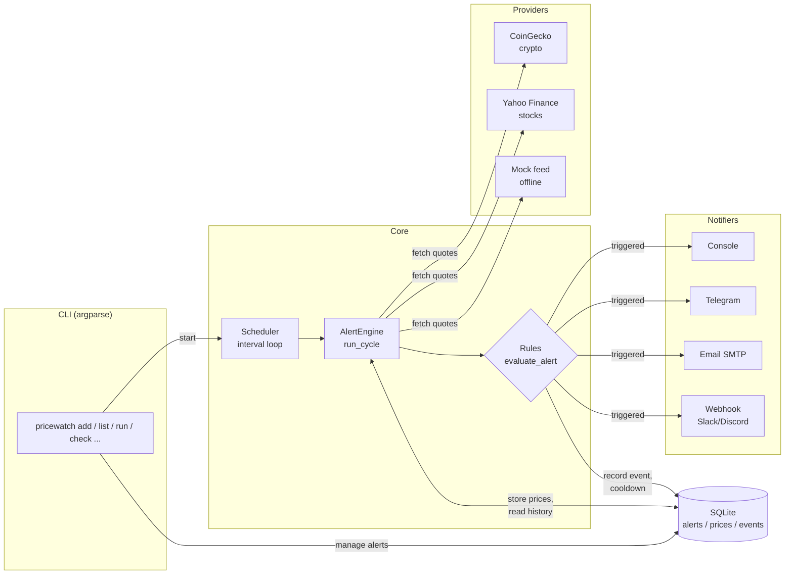
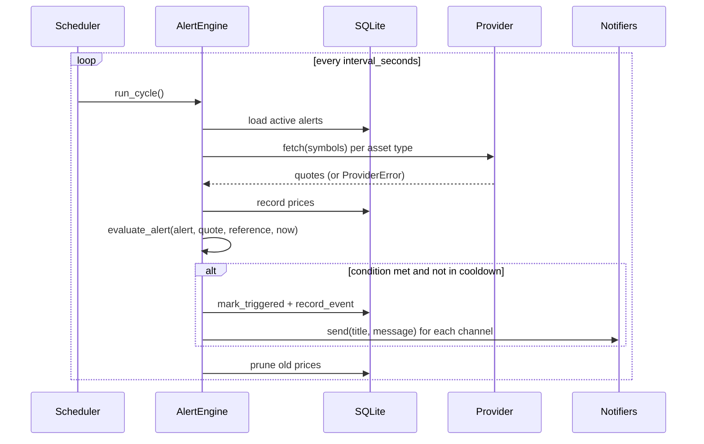

# pricewatch - Real-Time Crypto & Stock Alert Bot

[](https://github.com/your-username/pricewatch-bot/actions)


A production-style Python application that watches **cryptocurrency and stock prices**, evaluates
user-defined alert rules on an **automated schedule**, and pushes notifications to **console, Telegram,
e-mail or any webhook (Slack/Discord)**. Packaged as an installable CLI (`pricewatch`).

> Capstone project: *end-to-end logic integrating backend APIs, data processing and automated scheduling,
> packaged with `pyproject.toml`, a clear `argparse` CLI, tests, CI and documentation.*

## Features

- **Live data from real APIs** - crypto via [CoinGecko](https://www.coingecko.com/en/api), stocks via Yahoo Finance (no API keys needed).
- **Four alert types** - price `above` / `below` a level, or `rise` / `drop` by N% within a time window.
- **Automated scheduling** - drift-free interval scheduler with graceful `Ctrl+C` / `SIGTERM` shutdown; one bad cycle never kills the loop.
- **Persistent storage** - SQLite database for alerts, price history and a log of fired alerts; automatic retention pruning.
- **Resilient networking** - retries with exponential backoff, `Retry-After` support, per-symbol failure isolation.
- **Pluggable notifiers** - console, Telegram, SMTP e-mail, generic webhook. A failing channel never blocks the others; secrets never appear in logs.
- **Alert cooldowns** - no notification spam while a condition stays true.
- **Offline demo mode** - `--mock` simulates a price feed so you can try everything without network access.
- **Quality** - 34 automated tests, ruff linting, GitHub Actions CI on Python 3.11-3.13, Dockerfile, systemd unit.

## Architecture



### One check cycle



### Project layout

```
pricewatch/
├── pyproject.toml            # packaging, deps, console-script entry point
├── config.example.toml       # annotated configuration
├── Dockerfile
├── src/pricewatch/
│   ├── cli.py                # argparse commands
│   ├── engine.py             # alert rules + check cycle
│   ├── scheduler.py          # interval scheduler
│   ├── storage.py            # SQLite repository
│   ├── config.py             # TOML + env configuration
│   ├── models.py             # Alert / Quote / Trigger
│   ├── providers/            # coingecko.py, yahoo.py, mock.py, base.py (retry logic)
│   └── notifiers/            # console, telegram, email, webhook
├── tests/                    # 34 tests (pytest)
├── docs/                     # pricewatch.service (systemd), sample_run.log
├── scripts/demo.sh           # end-to-end demo
└── .github/workflows/ci.yml
```

## Installation

Requires **Python 3.11+**.

```bash
git clone https://github.com/your-username/pricewatch-bot.git
cd pricewatch-bot
python -m venv .venv && source .venv/bin/activate   # Windows: .venv\Scripts\activate
pip install -e .            # add ".[dev]" for tests and linting
pricewatch --version
```

## Quick start

```bash
# 1. Create alerts
pricewatch add BTC  --above 100000
pricewatch add ETH  --drop 5 --window 60            # -5% within 60 minutes
pricewatch add AAPL --type stock --below 180 --cooldown 120

# 2. See them
pricewatch list

# 3. Check the current price of anything
pricewatch price SOL
pricewatch price TSLA --type stock

# 4. Run once, or run continuously
pricewatch check
pricewatch run --interval 60
```

No internet? Add `--mock` to any command (or set `PRICEWATCH_MOCK=1`) to use the simulated feed.

### Example execution log (`bash scripts/demo.sh`)

```text
Created alert #1: BTC rises above 1,000.00 (cooldown 1 min)
Created alert #3: AAPL falls below 1,000.00 (cooldown 1 min)

pricewatch started (interval=5s, mock=True). Press Ctrl+C to stop.
BTC         10,478.60 USD  [mock]
ETH          4,075.01 USD  [mock]
AAPL           443.48 USD  [mock]
ALERT BTC is above 1,000.00 USD (now 10,478.60 USD)
🔔 Price alert #1: BTC
   BTC is above 1,000.00 USD (now 10,478.60 USD)
cycle done: 3 price(s), 3 alert(s) checked, 2 triggered, 0 error(s)
```

The complete log is in [`docs/sample_run.log`](docs/sample_run.log).

## CLI reference

| Command | Description |
|---|---|
| `pricewatch init [--path P] [--force]` | Write a sample config file |
| `pricewatch add SYMBOL [-t crypto\|stock] (--above P \| --below P \| --rise PCT \| --drop PCT) [--window MIN] [--cooldown MIN]` | Create an alert |
| `pricewatch list [--all]` | List alerts (`--all` includes paused) |
| `pricewatch pause ID` / `resume ID` / `remove ID` | Manage an alert |
| `pricewatch price SYMBOL [-t TYPE]` | Fetch a live price |
| `pricewatch check` | Run one check cycle and exit (cron friendly) |
| `pricewatch run [-i SECONDS] [--max-runs N]` | Run continuously on a schedule |
| `pricewatch history SYMBOL [-n N]` | Recorded price history |
| `pricewatch events [-n N]` | Alerts that have fired |
| `pricewatch test-notify` | Send a test message to every enabled channel |

Global options: `-c/--config FILE`, `--db FILE`, `--mock`, `-v` (debug logging), `--version`.

**Symbols:** crypto accepts common tickers (`BTC`, `ETH`, `SOL`, `DOGE`, ...) or any CoinGecko id (e.g. `avalanche-2`). Stocks use Yahoo tickers (`AAPL`, `TSLA`, `RELIANCE.NS`).

**Percentage alerts** compare the current price with the oldest sample recorded inside the window, so they become
accurate after the bot has been running for a while.

## Configuration

Run `pricewatch init` (writes `~/.pricewatch/config.toml`) or copy [`config.example.toml`](config.example.toml).
Lookup order: `--config`, `$PRICEWATCH_CONFIG`, `./pricewatch.toml`, `~/.pricewatch/config.toml`.

```toml
[general]
interval_seconds = 60
retention_days = 30

[notifiers.console]
enabled = true

[notifiers.telegram]
enabled = true
bot_token = "${TELEGRAM_BOT_TOKEN}"     # environment variables are expanded
chat_id   = "${TELEGRAM_CHAT_ID}"
```

| Environment variable | Purpose |
|---|---|
| `PRICEWATCH_DB` | SQLite path (default `~/.pricewatch/pricewatch.db`) |
| `PRICEWATCH_INTERVAL` | Seconds between checks |
| `PRICEWATCH_MOCK` | `1` to use the simulated feed |
| `PRICEWATCH_CONFIG` | Path to a config file |
| `COINGECKO_API_KEY` | Optional CoinGecko demo key for higher rate limits |

Keep secrets in environment variables, never in committed files (`pricewatch.toml` and `.env` are git-ignored).

### Setting up Telegram alerts
1. Talk to [@BotFather](https://t.me/BotFather), run `/newbot`, copy the token.
2. Send any message to your bot, then open `https://api.telegram.org/bot<TOKEN>/getUpdates` to find your `chat.id`.
3. Export `TELEGRAM_BOT_TOKEN` / `TELEGRAM_CHAT_ID`, enable `[notifiers.telegram]`, run `pricewatch test-notify`.

## Running it 24/7

**systemd:** see [`docs/pricewatch.service`](docs/pricewatch.service).

**Docker:**
```bash
docker build -t pricewatch .
docker run -d --name pricewatch -v pricewatch-data:/data \
  -e TELEGRAM_BOT_TOKEN=... -e TELEGRAM_CHAT_ID=... pricewatch
docker run --rm -v pricewatch-data:/data pricewatch add BTC --above 100000
```

**cron** (one-shot checks instead of a long-running process): `*/5 * * * * pricewatch check`

## Development

```bash
pip install -e ".[dev]"
pytest --cov=pricewatch     # 34 tests; no network required
ruff check src tests
```

All network code is injected (`requests.Session`, clocks, providers), so the whole suite runs offline.

### Adding a new data source or notifier
- **Provider:** subclass `Provider` in `src/pricewatch/providers/`, implement `fetch(symbols) -> {SYMBOL: Quote}`, register it in `build_providers`.
- **Notifier:** subclass `Notifier`, implement `send(title, message)`, and add a branch in `build_notifiers`.

## Design notes

- **Separation of concerns:** providers fetch, the engine decides, notifiers deliver, storage persists. `evaluate_alert` is a pure function.
- **Failure isolation:** a provider outage is reported in the cycle result, a single bad symbol doesn't affect others, and a broken notifier doesn't block the rest.
- **Free-API etiquette:** all symbols of one asset type are fetched per cycle (one CoinGecko request for all coins). Keep the interval at 60s or more.
- **Security:** parameterised SQL only; notifier errors never include tokens; non-root Docker user.

## Disclaimer

For educational purposes. Prices come from free third-party APIs and may be delayed or unavailable.
This is not financial advice - do not rely on it for trading decisions.

## License

MIT - see [LICENSE](LICENSE).
